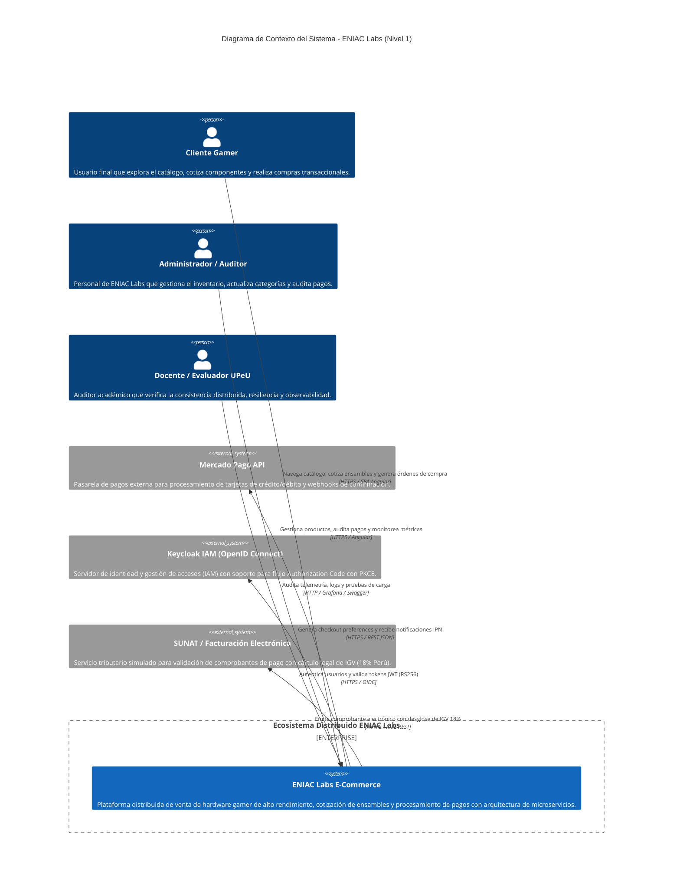

# 🌐 C4 Modelo - Nivel 1: Contexto del Sistema (System Context)

El **Diagrama de Contexto del Sistema** representa el nivel de mayor abstracción en el modelo C4. Establece la frontera perimetral del ecosistema **ENIAC Labs PC Gamer E-Commerce**, identificando a los usuarios clave (personas) y los sistemas externos con los que se comunica mediante protocolos de red e integraciones seguras.

---

## 1. Diagrama de Contexto (Mermaid C4Context)

---

## 2. Descripción de Actores (Personas)

| Actor | Rol en el Sistema | Interacción Principal | Protocolos / Canal |
| :--- | :--- | :--- | :--- |
| **Cliente Gamer** | Consumidor final | Consulta componentes, arma configuraciones de PC, efectúa pedidos transaccionales y realiza seguimiento de sus órdenes. | HTTPS / Navegador Web (Angular SPA `:4200`) |
| **Administrador / Auditor** | Gestión y Operación | Crea familias de productos, supervisa el stock en tiempo real, audita conciliaciones de pago en `pc-pago-ms`. | HTTPS / Panel de Administración Web |
| **Docente / Evaluador UPeU** | Fiscalización Académica | Supervisa la tolerancia a fallos (Circuit Breaker), eventos Kafka, rollback Saga e inspecciona métricas en Grafana/Prometheus. | HTTP / Grafana (`:3000`), Eureka (`:18761`), Swagger UI |

---

## 3. Descripción de Sistemas Externos

### 3.1 Keycloak IAM (`http://localhost:18180`)
- **Propósito**: Proveedor centralizado de Identidad y Gestión de Accesos (Identity and Access Management).
- **Protocolo**: OpenID Connect (OIDC) / OAuth 2.0.
- **Responsabilidad**: Emisión de tokens de acceso JWT firmados digitalmente (RS256) con claims de roles (`CLIENTE`, `ADMIN`), eliminando credenciales en texto plano y delegando el ciclo de vida de la sesión.

### 3.2 Mercado Pago API Sandbox
- **Propósito**: Pasarela de procesamiento de transacciones financieras internacionales y locales (Perú).
- **Protocolo**: HTTPS / REST JSON con firmas HMAC-SHA256 en webhooks IPN.
- **Responsabilidad**: Recepción del total de la orden generada, captura del cobro y notificación asíncrona hacia el microservicio `pc-pago-ms`.

### 3.3 SUNAT / Facturación Electrónica (Simulada)
- **Propósito**: Cumplimiento normativo y fiscal de la República del Perú.
- **Responsabilidad**: Validación del cálculo contable obligatorio de **IGV (18%)** sobre el subtotal de hardware facturado en `pc-orden-ms`.
