# 📦 C4 Modelo - Nivel 2: Contenedores (Container Diagram)

El **Diagrama de Contenedores** amplía el límite del sistema **ENIAC Labs E-Commerce** y expone las unidades ejecutables y desplegables (aplicaciones cliente, microservicios, bases de datos independientes, servidores de mensajería y componentes de observabilidad), detallando las decisiones tecnológicas, puertos y protocolos de comunicación.

---

## 1. Diagrama de Contenedores (Mermaid C4Container)

```mermaid
C4Container
    title Diagrama de Contenedores - ENIAC Labs E-Commerce (Nivel 2)

    Person(cliente, "Cliente / Administrador", "Navegador Web de escritorio o móvil")

    System_Boundary(c1, "Límite del Sistema ENIAC Labs") {
        Container(spa, "Single Page Application", "Angular 22, TypeScript, Tailwind/Vanilla CSS", "Interfaz reactiva gamer, catálogo dinámico, carrito de compras, gestión de órdenes y autenticación PKCE.")
        Container(gateway, "API Gateway Perimetral", "Spring Cloud Gateway WebMVC, Java 21", "Punto único de entrada (:18080). Enrutamiento dinámico, validación de JWT, balanceo de carga y rate limiting.")
        
        Container(keycloak_c, "IAM & Auth Server", "Keycloak 24, OpenID Connect", "Gestión de identidades (:18180). Emisión y firma de tokens JWT RS256 con roles CLIENTE y ADMIN.")
        Container(eureka, "Service Discovery", "Spring Cloud Netflix Eureka", "Registro y descubrimiento dinámico de instancias (:18761 / :8761).")
        Container(config_srv, "Config Server", "Spring Cloud Config Native", "Servidor de configuración centralizada (:18888 / :8888).")

        Container(orden_ms, "pc-orden-ms (Transaccional)", "Spring Boot 3.4.3, OpenFeign, Resilience4j", "Único microservicio transaccional (:8083). Persistencia ACID, cabecera-detalle, IGV 18%, Saga stock reservation.")
        Container(catalogo_ms, "pc-catalogo-ms (No Transaccional)", "Spring Boot 3.4.3, Spring Data JPA", "Catálogo maestro (:8081). Gestión de hardware, familias/categorías y stock en tiempo real con Redis.")
        Container(cotizacion_ms, "pc-cotizacion-ms (No Transaccional)", "Spring Boot 3.4.3", "Motor de cotizaciones y proformas de 7 días para ensambles PC Builder (:8089).")
        Container(pago_ms, "pc-pago-ms (Satélite)", "Spring Boot 3.4.3, SDK Mercado Pago", "Gestión de cobros y webhooks de pasarela (:8085).")

        ContainerDb(db_orden, "BD Órdenes", "PostgreSQL 16 (:5433)", "Esquema ACID: orden_compra, orden_compra_detalle.")
        ContainerDb(db_cat, "BD Catálogo", "PostgreSQL 16 (:15432)", "Esquema: producto_hardware, categoria_hardware.")
        ContainerDb(db_coti, "BD Cotizaciones", "PostgreSQL 16 (:5436)", "Esquema: cotizacion_builder, item_cotizacion.")
        ContainerDb(db_pago, "BD Pagos", "PostgreSQL 16 (:5434)", "Esquema: transaccion_pago, auditoria_pago.")
        ContainerDb(db_kc, "BD Keycloak", "PostgreSQL 16 (:5435)", "Esquema relacional de usuarios, realms, roles y credenciales.")

        ContainerDb(redis_c, "Inventario Redis Cache", "Redis 7 Alpine (:6379)", "Caché de alta velocidad para stock y candados distribuidos de reserva.")
        Container(kafka_b, "Broker de Eventos", "Apache Kafka 3.7 (:9092)", "Bus de mensajería asíncrona: orden.creada, pago.procesado, pago.rechazado.")

        Container(prom, "Prometheus", "Prometheus 2.51 (:9090)", "Recolector de métricas Actuator / JVM / Micrometer de todos los microservicios.")
        Container(graf, "Grafana", "Grafana 10.4 (:3000)", "Dashboards interactivos de salud, throughput, latencia y logs.")
        Container(loki_c, "Loki & Promtail", "Grafana Loki (:3100)", "Agregación y búsqueda de logs distribuidos.")
    }

    System_Ext(mp_ext, "Mercado Pago Sandbox", "Pasarela de Pago Externa")

    Rel(cliente, spa, "Interactúa con la interfaz web", "HTTPS / :4200")
    Rel(spa, keycloak_c, "Flujo Authorization Code con PKCE", "HTTPS / OIDC")
    Rel(spa, gateway, "Llamadas a la API REST", "HTTPS / JSON (:18080/api/...)")

    Rel(gateway, eureka, "Consulta ubicación de servicios", "HTTP REST")
    Rel(gateway, orden_ms, "Enruta /api/v1/ordenes/**", "HTTP / lb://pc-orden-ms")
    Rel(gateway, catalogo_ms, "Enruta /api/v1/productos/**", "HTTP / lb://pc-catalogo-ms")
    Rel(gateway, cotizacion_ms, "Enruta /api/v1/cotizaciones/**", "HTTP / lb://pc-cotizacion-ms")
    Rel(gateway, pago_ms, "Enruta /api/v1/pagos/**", "HTTP / lb://pc-pago-ms")

    Rel(orden_ms, catalogo_ms, "Reserva de stock síncrona", "Feign Client + Circuit Breaker")
    Rel(orden_ms, kafka_b, "Emite orden.creada tras commit", "Kafka Binary Protocol (:9092)")
    Rel(kafka_b, pago_ms, "Consume orden.creada", "Kafka Consumer")
    Rel(pago_ms, kafka_b, "Emite pago.procesado / rechazado", "Kafka Producer")
    Rel(kafka_b, orden_ms, "Consume pago.procesado (actualiza estado)", "Kafka Consumer")

    Rel(catalogo_ms, redis_c, "Consulta y bloquea stock", "RESP Protocol")
    Rel(pago_ms, mp_ext, "Genera checkout preference", "HTTPS REST")

    Rel(orden_ms, db_orden, "Lectura / Escritura ACID", "JDBC (:5433)")
    Rel(catalogo_ms, db_cat, "Lectura / Escritura", "JDBC (:15432)")
    Rel(cotizacion_ms, db_coti, "Lectura / Escritura", "JDBC (:5436)")
    Rel(pago_ms, db_pago, "Lectura / Escritura", "JDBC (:5434)")
    Rel(keycloak_c, db_kc, "Lectura / Escritura", "JDBC (:5435)")

    Rel(prom, gateway, "Scrape métricas /actuator/prometheus", "HTTP")
    Rel(prom, orden_ms, "Scrape métricas /actuator/prometheus", "HTTP")
    Rel(prom, catalogo_ms, "Scrape métricas /actuator/prometheus", "HTTP")
    Rel(graf, prom, "Consulta series temporales", "PromQL")
    Rel(graf, loki_c, "Consulta logs distribuidos", "LogQL")
```

---

## 2. Catálogo de Contenedores y Roles Arquitectónicos

### 2.1 Aplicaciones y Capa Perimetral

| Contenedor | Tecnología | Puerto | Rol Arquitectónico |
| :--- | :--- | :--- | :--- |
| **Frontend Gamer SPA** | Angular 22, TypeScript, RxJS, Signals | `:4200` | Cliente web moderno con soporte para PKCE OIDC, vistas reactivas y actualización de pedidos por polling inteligente. |
| **API Gateway** | Spring Cloud Gateway WebMVC, Java 21 | `:18080` | Puerta de enlace perimetral. Realiza inspección de cabeceras, enrutamiento dinámico `lb://` mediante Eureka y limitación de peticiones. |
| **Keycloak IAM** | Keycloak 24 Quay, OpenJDK | `:18180` | Servidor de autenticación y autorización. Emite tokens JWT con roles `CLIENTE` y `ADMIN` sobre el realm `eniaclabs`. |
| **Eureka Registry** | Spring Cloud Netflix Eureka Server | `:18761` / `:8761` | Directorio de servicios distribuido con heartbeat de salud para el descubrimiento sin IP estática. |
| **Config Server** | Spring Cloud Config Native | `:18888` / `:8888` | Servidor de perfiles de configuración centralizada (`application-dev.yml`). |

---

### 2.2 Microservicios de Dominio (Negocio)

| Microservicio | Tipo | Puerto | Responsabilidad Técnica |
| :--- | :--- | :--- | :--- |
| **`pc-orden-ms`** | **Transaccional (ACID)** | `:8083` | **Único microservicio transaccional**. Gestiona cabecera-detalle, aplica el **18% de IGV**, efectúa reserva de inventario con compensación Saga y emite `orden.creada` solo tras el `commit` local en PostgreSQL. |
| **`pc-catalogo-ms`** | **No Transaccional** | `:8081` | Microservicio maestro de consulta de hardware y mantenimiento de inventario. Provee endpoints de alta velocidad con caché Redis. |
| **`pc-cotizacion-ms`** | **No Transaccional** | `:8089` | Motor de proformas gamer sin compromiso financiero. Valida compatibilidad de sockets, wattaje de fuentes y vigencia de 7 días. |
| **`pc-pago-ms`** | **Satélite / Pasarela** | `:8085` | Gestiona el ciclo de vida del cobro con Mercado Pago y emite eventos de pago a Kafka. |

---

### 2.3 Persistencia y Mensajería (Database-per-Service)

| Instancia | Tecnología | Puerto | Justificación de Aislamiento |
| :--- | :--- | :--- | :--- |
| **`db-orden`** | PostgreSQL 16 | `:5433` | Aislamiento transaccional para órdenes de compra y detalles de facturación. |
| **`db-catalogo`** | PostgreSQL 16 | `:15432` | Persistencia de familias de componentes, marcas, modelos y especificaciones. |
| **`db-cotizacion`** | PostgreSQL 16 | `:5436` | Persistencia de proformas temporales y ensambles personalizados. |
| **`db-pago`** | PostgreSQL 16 | `:5434` | Auditoría de comprobantes y logs de pasarela Mercado Pago. |
| **`db-keycloak`** | PostgreSQL 16 | `:5435` | Esquema relacional interno de usuarios, credenciales y sesiones IAM. |
| **`Redis`** | Redis 7 Alpine | `:6379` | Caché en memoria para consulta sub-milisegundo de stock y candados distribuidos. |
| **`Apache Kafka`** | Kafka 3.7 KRaft | `:9092` | Broker asíncrono para eventos `orden.creada`, `pago.procesado` y `pago.rechazado`. |
