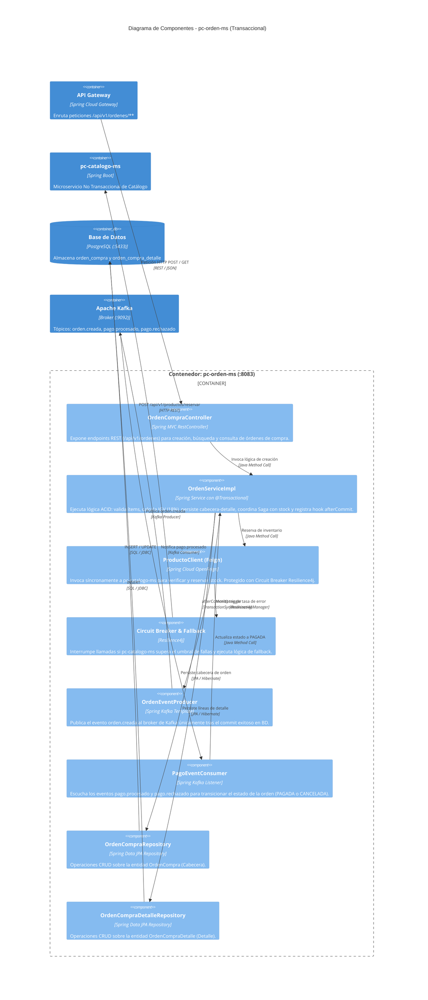
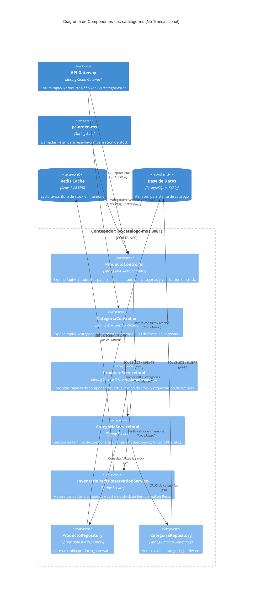

# ⚙️ C4 Modelo - Nivel 3: Componentes (Component Diagram)

El **Diagrama de Componentes** realiza un zoom sobre los microservicios principales del sistema, en particular sobre el **Microservicio Transaccional ([`pc-orden-ms`](file:///c:/Users/USUARIO/Music/nicro3/2/pc-orden-ms))** y el **Microservicio No Transaccional ([`pc-catalogo-ms`](file:///c:/Users/USUARIO/Music/nicro3/2/pc-catalogo-ms))**, detallando sus controladores REST, servicios de lógica de negocio, clientes Feign con Circuit Breaker, productores/consumidores de Kafka y repositorios JPA.

---

## 1. Diagrama de Componentes de `pc-orden-ms` (Transaccional)

---

## 2. Diagrama de Componentes de `pc-catalogo-ms` (No Transaccional)

---

## 3. Matriz de Componentes

| Microservicio | Componente | Rol Técnico |
| :--- | :--- | :--- |
| **`pc-orden-ms`** | `OrdenCompraController` | Controlador perimetral que recibe la solicitud de orden, extrae cabeceras de usuario (`X-User-Id`) y devuelve el DTO con el desglose contable. |
| **`pc-orden-ms`** | `OrdenServiceImpl` | Lógica de negocio con `@Transactional`. Realiza el cálculo del **18% de IGV** con redondeo legal `HALF_UP`, orquesta la compensación Saga y activa el hook `afterCommit`. |
| **`pc-orden-ms`** | `ProductoClient` | Cliente Feign con tolerancia a fallos Resilience4j (`@CircuitBreaker(name = "catalogoService")`) para comunicarse con `pc-catalogo-ms`. |
| **`pc-catalogo-ms`** | `ProductoController` | Expone endpoints para búsqueda por SKU, filtrado por categorías y verificación de stock disponible. |
| **`pc-catalogo-ms`** | `ProductoServiceImpl` | Lógica de consulta de hardware con `@Transactional(readOnly = true)` para optimizar lecturas directas en PostgreSQL. |
| **`pc-catalogo-ms`** | `InventarioRedisReservationService` | Bloqueo atómico y decremento de stock en Redis previo a la confirmación de la orden. |
