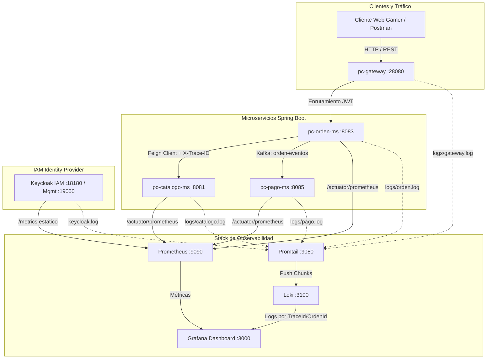

# S10 - Observabilidad y Diagnóstico de Sistemas Distribuidos
**Proyecto Sello:** ENIAC Labs (E-Commerce de Hardware Gamer y Componentes de Alto Rendimiento)  
**Integrantes:** Eliceo Parillo Mostajo & Laura Vargas Cristhian Paul  
**Semana:** S10 - Unidad II: Sistema Distribuido Robusto

---

## 1. Introducción y Arquitectura de Observabilidad

En **ENIAC Labs**, la arquitectura de observabilidad combina **Prometheus** (recolección de métricas numéricas y series temporales), **Promtail + Loki** (ingesta, indexación y agregación de logs estructurados) y **Grafana** (visualización unificada en tableros de diagnóstico en tiempo real).

### Huecos de Observabilidad Resueltos en S10
1. **Health Checks Avanzados:** Actuator por defecto responde únicamente `{"status":"UP"}` o `{"status":"DOWN"}` sin discernir la causa raíz. Se configuraron health groups explícitos:
   - `/actuator/health/liveness`: Verifica que la JVM de los microservicios (`pc-catalogo-ms`, `pc-orden-ms`, `pc-pago-ms`) no esté bloqueada.
   - `/actuator/health/readiness`: Verifica la disponibilidad de dependencias críticas externas (`readinessState, db` para PostgreSQL).
2. **Monitoreo de Keycloak (IAM):** Keycloak no es un microservicio Spring Cloud ni cliente de Eureka Discovery. Se integró a Prometheus mediante un `static_config` en su puerto de gestión (`19000` en DEV / `9000` en contenedor) consumiendo la ruta `/metrics`.
3. **Centralización de Logs con Promtail:** Se incorporaron los appenders de archivo `logback-spring.xml` para `pc-gateway` (`logs/gateway.log`) y se enrutaron los logs de `keycloak`, `pc-gateway` y `pc-pago-ms` hacia Loki.
4. **Propagación Distribuida de Trace ID:** Implementación de `FeignTraceConfig` con `RequestInterceptor` en `pc-orden-ms` para propagar los encabezados `X-Trace-ID` y `X-Correlation-Id` en las llamadas síncronas hacia `pc-catalogo-ms`.



---

## 2. Health Groups: Liveness vs. Readiness

### Fundamento Técnico
| Parámetro | Liveness (`/actuator/health/liveness`) | Readiness (`/actuator/health/readiness`) |
| :--- | :--- | :--- |
| **Pregunta que responde** | ¿Sigue vivo el proceso o debe reiniciarse? | ¿Puede aceptar tráfico y procesar órdenes ahora mismo? |
| **Componentes revisados** | JVM, estado de hilos, bucles infinitos, deadlocks. | Conectividad a PostgreSQL (`db`), Kafka brokers, dependencias de red. |
| **Acción ante fallo** | El orquestador (K8s/Docker) reinicia el contenedor. | El API Gateway saca la instancia de la rotación sin reiniciar el contenedor. |
| **Ejemplo en ENIAC Labs** | Proceso `pc-pago-ms` corriendo en JVM. | PostgreSQL de pagos se desconecta por mantenimiento o saturación. |

### Configuración en Config Server (`config-repo/*.yml`)
Se configuró en `pc-catalogo-ms-dev.yml`, `pc-orden-ms-dev.yml` y `pc-pago-ms-dev.yml`:

```yaml
management:
  endpoints:
    web:
      exposure:
        include: health,info,metrics,prometheus
  endpoint:
    health:
      show-details: always
      probes:
        enabled: true
      group:
        liveness:
          include: livenessState
        readiness:
          include: readinessState, db
```

---

## 3. Propagación de Traza con Feign Interceptor

Al procesar una compra de una tarjeta gráfica (e.g., *NVIDIA GeForce RTX 4090*), `pc-orden-ms` intercepta la petición HTTP y registra en el MDC de SLF4J un identificador único mediante `CorrelationIdFilter`. Para evitar que la llamada síncrona a `pc-catalogo-ms` genere un ID desvinculado, se creó `FeignTraceConfig`:

```java
package pe.edu.upeu.eniaclabs.orden.config;

import feign.RequestInterceptor;
import org.slf4j.MDC;
import org.springframework.context.annotation.Bean;
import org.springframework.context.annotation.Configuration;

@Configuration
public class FeignTraceConfig {

    public static final String TRACE_ID_HEADER = "X-Trace-ID";
    public static final String CORRELATION_ID_HEADER = CorrelationIdFilter.CORRELATION_ID_HEADER;

    @Bean
    public RequestInterceptor traceIdInterceptor() {
        return template -> {
            String correlationId = MDC.get(CorrelationIdFilter.CORRELATION_ID_MDC_KEY);
            if (correlationId != null) {
                template.header(CORRELATION_ID_HEADER, correlationId);
                template.header(TRACE_ID_HEADER, correlationId);
            }
        };
    }
}
```

---

## 4. Tablero de Diagnóstico en Grafana

En Grafana (`http://localhost:3000`), el dashboard **"S10 - Diagnóstico de ENIAC Labs"** cuenta con 4 paneles esenciales:

1. **Estado de Servicios (UP):** Consulta PromQL `up{job=~"pc-.*"}`. Visualización tipo Stat/Table para detectar caídas instantáneas.
2. **Tasa de Peticiones (Throughput):** `sum by (application) (rate(http_server_requests_seconds_count[1m]))`. Curva de tráfico en tiempo real.
3. **Tasa de Errores HTTP 5xx:** `sum by (application) (rate(http_server_requests_seconds_count{status=~"5.."}[1m]))`. Alerta temprana de degradación.
4. **Logs Centralizados por TraceId:** LogQL `{job=~"eniaclabs-.*"} |= "traceId"` o búsqueda directa de errores como `{application="pc-pago-ms"} |= "ordenId"`.

---

## 5. Simulación de Falla y Diagnóstico

### Escenario de Prueba
Se simuló la caída abrupta de `pc-pago-ms` deteniendo su contenedor:
1. **Detección en el Tablero:** El panel *Servicios Arriba* reflejó inmediatamente `pc-pago-ms = 0` (DOWN).
2. **Comportamiento Asíncrono:** Se registró una orden de un procesador *AMD Ryzen 9 7950X*. La orden se persistió en `PENDIENTE_PAGO` y el evento `orden.creada` quedó encolado en el topic `orden-eventos` de Kafka.
3. **Restablecimiento del Servicio:** Al reiniciar `pc-pago-ms`, el consumidor Kafka reanudó el offset pendiente, procesó la transacción idempotentemente y emitió `pago.exitoso`. El panel de logs de Loki confirmó:
   ```
   [pc-pago-ms] INFO  p.e.u.e.p.s.PagoServiceImpl - component=processor ordenId=45 estado=APROBADO status=processed
   ```

---

## 6. Reflexión Técnica: Incidente Knight Capital vs. Liveness/Readiness

En agosto de 2012, **Knight Capital Group** perdió 440 millones de dólares en 45 minutos debido a un despliegue de código imperfecto que reactivó un algoritmo obsoleto (Power Peg). Los sistemas de monitoreo tradicionales mostraban que los procesos estaban "vivos" (`liveness` = UP), respondiendo y enviando millones de transacciones a la bolsa. Sin embargo, el sistema **no estaba listo para operar correctamente** (`readiness` = DOWN) debido a que el software operaba bajo supuestos erróneos de negocio sin validación de precondiciones de consistencia.

En una arquitectura de microservicios distribuida como **ENIAC Labs**, separar `liveness` de `readiness` garantiza que si una base de datos o pasarela de pagos experimenta fallas o latencia crítica, el servicio informa al orquestador que **no está listo para recibir tráfico** (`readiness = DOWN`), permitiendo que el API Gateway o Kubernetes desvíe las solicitudes sin provocar reinicios destructivos de procesos sanos.
