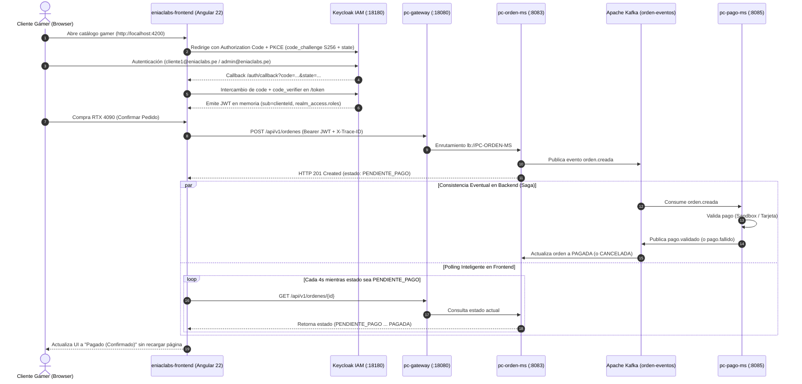

# S11 - Integración con Cliente Frontend: Angular 22 sobre el Gateway, con Keycloak
**Proyecto Sello:** ENIAC Labs (E-Commerce de Hardware Gamer y Componentes de Alto Rendimiento)  
**Integrantes:** Eliceo Parillo Mostajo & Laura Vargas Cristhian Paul  
**Semana:** S11 - Unidad II: Sistema Distribuido Robusto

---

## 1. Introducción y Arquitectura de Integración

En **ENIAC Labs**, el frontend representa la culminación del ecosistema distribuido construido desde S01. La SPA construida sobre **Angular 22** se integra de manera desacoplada a través de **pc-gateway (Spring Cloud Gateway WebMVC)** y autentica sus usuarios contra **Keycloak IAM (Realm: eniaclabs)** utilizando el flujo seguro estándar **Authorization Code Flow con PKCE (Proof Key for Code Exchange)**.



---

## 2. CORS Centralizado en el Gateway

El cliente frontend corre en `http://localhost:4200` y consume la API a través de `http://localhost:18080`. Para evitar bloqueos por política de mismo origen (*Same-Origin Policy*), se configuró CORS a nivel centralizado en el Gateway:

1. **`infra/pc-gateway/src/main/java/pe/edu/upeu/eniaclabs/gateway/config/CorsConfig.java`**:
   Registra un `CorsConfigurationSource` habilitando `GET, POST, PUT, PATCH, DELETE, OPTIONS`, `AllowedHeaders=*` y `AllowCredentials=true`.
2. **`SecurityConfig.java` en pc-gateway**:
   Habilita `.cors(cors -> {})` para admitir las peticiones preflight `OPTIONS` del navegador sin exigir cabecera `Authorization`.
3. **`infra/pc-config/config-repo/pc-gateway-dev.yml`**:
   ```yaml
   eniaclabs:
     cors:
       allowed-origins: http://localhost:4200
   ```

---

## 3. Seguridad SPA: Authorization Code + PKCE con Keycloak

### Decisión de Arquitectura y Manejo de Tokens
| Componente | Ubicación / Tratamiento | Razón Técnica y Protección |
| :--- | :--- | :--- |
| **Access & Refresh Tokens** | **En memoria (Signal Angular)** | Evita vulnerabilidad crítica a robo de tokens vía Cross-Site Scripting (XSS) en `localStorage`. |
| **`code_verifier`** | `sessionStorage` transitorio | Persiste únicamente durante la redirección de login a Keycloak; se destruye inmediatamente tras el canje. |
| **`state` Anti-CSRF** | Generado con Web Crypto API (16 bytes) | Se valida en `/auth/callback` contra el parámetro devuelto para prevenir ataques de falsificación de petición. |
| **Identificador `sub`** | Claim estándar OIDC | Representa el `idCliente` técnico único generado por Keycloak, eliminando mappers ad-hoc redundantes. |

---

## 4. Consistencia Eventual en la Interfaz (Estrategia de Polling)

Debido a que la comunicación entre `pc-orden-ms` y `pc-pago-ms` es 100% asíncrona desacoplada por eventos de Apache Kafka (S08 y S09), una respuesta `HTTP 201 Created` en la creación de una orden **no significa que la orden esté pagada**. Representa únicamente que la orden fue persistida en estado `PENDIENTE_PAGO`.

### Comparativa de Estrategias para la UI
1. **Recarga Manual:** Pésima experiencia de usuario (traslada la incertidumbre al cliente gamer).
2. **WebSockets / Server-Sent Events:** Ideal para alto volumen, pero requiere infraestructura de push persistente y broker de sockets en el gateway.
3. **Polling Inteligente Periódico (Estrategia Implementada en `MisPedidos`):**
   - Sondeo mediante `setInterval` cada 4000ms.
   - **Optimización de tráfico:** Solo re-consulta aquellas órdenes que se encuentren estrictamente en `PENDIENTE_PAGO`.
   - Una vez que la orden cambia a `PAGADA` o `CANCELADA`, sale automáticamente del ciclo de sondeo y consulta el detalle del pago en `GET /api/v1/pagos/por-orden/{ordenId}`.
   - En `ngOnDestroy()`, se ejecuta `clearInterval` para evitar fugas de memoria o peticiones huérfanas en segundo plano.

---

## 5. Simulación de Casos de Negocio de Punta a Punta

### Caso Feliz: Aprobación Inmediata de Compra Gamer
1. El cliente inicia sesión con usuario `cliente1@eniaclabs.pe`.
2. Selecciona una tarjeta gráfica *NVIDIA GeForce RTX 4090 OC (24GB GDDR6X)* por un monto de `S/ 8499.00`.
3. Selecciona método de pago `YAPE_PLIN` y hace clic en **Confirmar Pedido**.
4. La UI muestra la orden creada en estado `PENDIENTE_PAGO` y redirige a **Mis Pedidos**.
5. En menos de 4 segundos, el polling detecta que el consumidor de Kafka procesó el evento y la orden pasa sola a `PAGADA (Confirmado)`.

### Caso de Fallo: Rechazo de Tarjeta y Compensación (Saga Rollback)
1. El cliente selecciona un procesador *Intel Core i9-14900KS*.
2. Elige el método de pago `TARJETA_RECHAZADA` (sandbox de rechazo intencional).
3. La orden se crea inicialmente en `PENDIENTE_PAGO`.
4. `pc-pago-ms` detecta el fallo bancario simulado, publica el evento `pago.fallido` y `pc-orden-ms` ejecuta la transacción compensatoria cancelando la orden.
5. El polling en la pantalla **Mis Pedidos** actualiza el registro en tiempo real a `CANCELADA (Pago Rechazado)`.

---

## 6. Reflexión Técnica: Incidente Starbucks (Race Condition)

En marzo de 2015, Egor Homakov descubrió una condición de carrera en el sistema de tarjetas de regalo de Starbucks: al enviar transferencias simultáneas desde dos sesiones distintas, el backend no serializaba el saldo y duplicaba los fondos. 

Este incidente demuestra que **la consistencia distribuida es intrínseca a la seguridad del sistema**. Si el frontend Angular asumiera ingenuamente que la respuesta `HTTP 201` significa "compra exitosa", o si permitiera que el usuario haga múltiples clics sobre "Confirmar Pedido" sin deshabilitar el botón (`[disabled]="enviando()"`), se generarían eventos duplicados en Kafka. En **ENIAC Labs**, la arquitectura protege la integridad en dos frentes:
1. **Frontend:** Bloqueo de UI (`enviando = true`) y representación honesta de estados transitorios (`PENDIENTE_PAGO`).
2. **Backend:** Consumidor idempotente en `pc-pago-ms` con clave única `ordenId` y captura de `DataIntegrityViolationException`.
